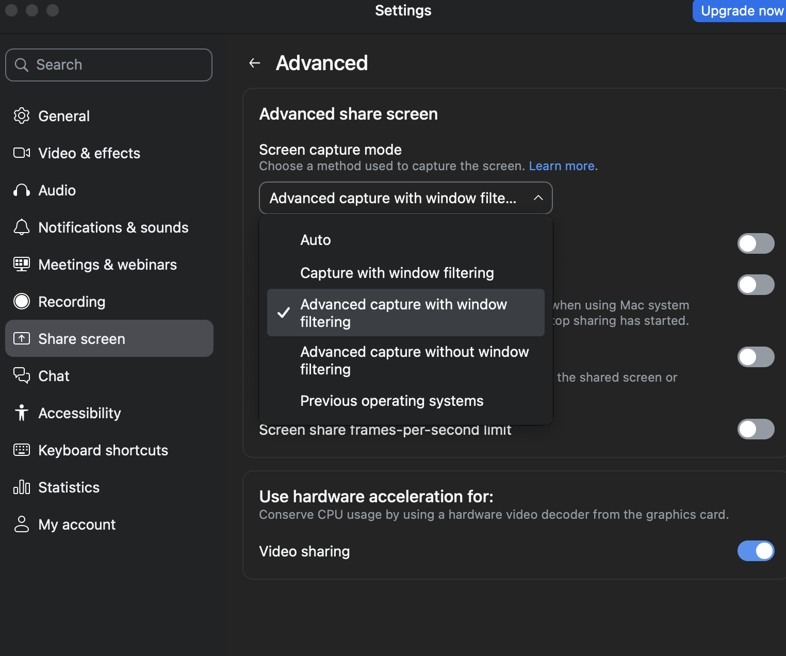

<div align="center">

# cue

**An open-source AI copilot that floats over your screen — sees what you see, hears your meetings, and stays hidden from screen shares.**

A free, self-hosted alternative to Cluely. Bring your own AI key (OpenAI · Anthropic · Google Gemini · Azure AI Foundry . OpenAI-compatible endpoints).

[Website](https://cue.dumpydon.workers.dev/) · [Download for Mac](https://cue.dumpydon.workers.dev/install/) · [Launch film](https://cue.dumpydon.workers.dev/#film)

</div>

---

> [!IMPORTANT]
> **Please read this first.** cue tries to stay out of screen recordings/shares, but this is **best-effort, not guaranteed** — on macOS 15.4+ Apple can let modern capture tools see it anyway, on Windows 10 builds older than 2004 it degrades to a black box instead of true exclusion, and a phone camera always can. Using a hidden assistant during a **proctored exam, job interview, or recorded meeting** may break that platform's rules and, in some places, consent laws. cue is built for legitimate uses — your own notes, studying, accessibility, and practice. **You are responsible for how you use it.**

---

## What it does

cue floats a small glass panel on top of everything. It takes **three separate inputs** — your **screen**, your **microphone**, and your **meeting audio** (what the other person says) — and uses an AI model to help you in real time.

| Feature | How to trigger | What it uses |
|---|---|---|
| **Smart assist** | `⌘` `⇧` `↵` (macOS) or `Ctrl` `Shift` `Enter` (Windows) | your screen + recent conversation |
| **What should I say?** | `⌘` `↵` (macOS) or `Ctrl` `Enter` (Windows) | meeting audio + your mic |
| **Recap** | button | the whole conversation |
| **Ask anything** | type + `↵` | your screen + conversation |
| **Solve a coding problem** | `⌘` `H` (macOS) or `Ctrl` `H` (Windows) | your screen only |
| **Smart** toggle | pill in the box | switches to a smarter (slower) model |
| **Saved sessions** | history icon in the toolbar, or menu bar → View Sessions | locally saved conversations and notes |

The Omnitrix-inspired Cue icon uses a rounded square for the app and a monochrome circular mark in the macOS menu bar. The menu-bar icon appears in visible mode (eye) and is removed in hidden mode (hat and glasses). Its menu can start/stop listening, hide/show Cue, enable invisibility, open saved sessions or preferences, and quit.

`⌘−` / `⌘+` (`Ctrl−` / `Ctrl+` on Windows) scale the content while keeping the window and its transparent sidebar gutters fixed. Use `⌘0` / `Ctrl0` for actual size. Drag any edge or corner to resize; the bottom-right grip is icon-only.

Technical answers support syntax-highlighted code blocks with language labels and **Copy code**, inline and display mathematics, headings, lists, and tables. Code and formulas render while the answer streams. Use fenced code with a language tag such as `python`, `cpp`, or `java`; use `\( ... \)` for inline math and `\[ ... \]` or `$$ ... $$` for equations. Rendering libraries and math fonts are bundled locally. Saved session summaries and notes use the same formatting.

Completed responses include **Copy answer** for readable text and **Copy Markdown** for the original formatting, code fences, and LaTeX. Each code block has a **Wrap / Unwrap** control; its setting survives streaming updates. Prose uses a comfortable line length on wide windows, with clearer headings, numbered steps, and comparison tables. Scrolling up pauses automatic following, and **Latest answer** returns to the newest content. Response guidance adapts structure to the question while keeping spoken replies concise.

Brand sources live in `renderer/assets/*.svg`; run `node scripts/build-icon.js` to regenerate PNG, ICO and (on macOS) ICNS assets before packaging.

It's a copilot for **live meetings** ("what do I say to that?") and **coding problems** (screenshot → full solution), and it's designed to be **invisible in screen shares** so it stays your private assistant.

Fast and Smart use editable model dropdowns. OpenAI choices include GPT-6.1 Sol, GPT-6 Astra, GPT-6 Sol, GPT-6 Luna, and the GPT-5.6 Sol / Terra / Luna family. Opening Settings refreshes compatible choices from OpenAI's [List models API](https://developers.openai.com/api/reference/resources/models/methods/list), with a short cache and a manual refresh button. Newly listed GPT-6.x aliases can appear without an app update. Other model IDs can be typed once and saved.

Your model list is local to each provider and shared between Fast and Smart. Completed answers rank frequently used models first. The trash button removes a model from your choices, including the default suggestions; it does not change the active model. Deletions survive saving and relaunching. Typing and explicitly selecting the same ID adds it back.

The four-square **Modes** button opens a quick picker; **Manage modes** opens the editor. You can also open Modes from Settings. Each mode has an editable title, meeting context, and its own files. General, Interview, Behavioral Interview, Coding Interview, System Design, Case Interview, Recruiter Screen, Sales, Recruiting, Team Meet, and Lecture are included. Editing a mode does not activate it: choose **Set Active** when ready. Active-mode edits apply to the next request automatically. The supplied interview presets use real background and explicit placeholders for missing experience.

Titles and contexts save automatically. Pending edits also save before an AI request or normal quit; a failed write keeps the draft available for retry. Drag a sidebar grip to reorder, use the small up/down buttons, or focus a grip and press Alt+Up/Down. The quick picker uses the same saved order. New modes, duplication, deletion, and undo are available; the last 20 deleted modes can be restored in order with Undo delete.

Mode files support PDF, DOCX, TXT, and Markdown (5 MB each, up to 10 per mode). Their extracted text is saved locally with the mode; originals are unchanged. Scanned PDFs require a text layer. Each file contributes up to 40,000 characters, with truncation shown in the editor, and each mode accepts up to 100,000 file-text characters. Only the active mode's context and files accompany user-facing AI requests, including coding actions; background meeting notes and slide extraction retain their factual task prompts. Importing or editing modes never calls an AI provider.

The overlay can be parked beyond the left, right, or bottom screen edge, keeping about 20% visible (at least 100 points across and 80 points vertically) so the exposed background can pull it back. Bottom corners also work. These limits follow the physical display edges even when the Dock reserves space. Its size stays fixed during dragging, and parked positions survive release, resizing, and relaunch. Opening Settings or Sessions brings the window fully into view.

During a live session, the compact **You** microphone waveform and **Call** system-audio bars show which input is receiving sound. They follow actual audio levels, settle during silence, and show muted or unavailable sources independently. Their header shares the existing transcription status area, keeping answers visible in a small overlay. Hover either icon for its state. These meters do not enable capture or make extra provider requests; meeting audio still needs its existing opt-in and permissions. See [live audio inputs](docs/audio-activity.md).

Typed follow-ups retain a bounded, memory-only answer thread. **New thread** clears generated answers while keeping the live transcript. Spoken reply actions use the actual conversation, with provisional speech identified and the latest question prioritized. See [response context](docs/response-generation.md).

### Platform support

|  | macOS | Windows 11 / 10 2004+ |
|---|---|---|
| Screen + coding help | ✅ | ✅ |
| Your mic (the **You** channel) | ✅ | ✅ |
| Meeting audio (the **Them** channel) | ✅ macOS 14.4+ | ✅ |
| Hidden from screen shares | ⚠️ best-effort, weaker on macOS 15.4+ | ✅ `WDA_EXCLUDEFROMCAPTURE` |
| Permissions to grant | Microphone **and** Screen Recording | Microphone only |

> [!NOTE]
> **Meeting audio needs macOS 14.4+.** Capturing the *other* person — what powers **What should I say?** and **Recap** — uses system-audio loopback. On Windows that works out of the box. On macOS it relies on ScreenCaptureKit, which cue enables through Chromium's `MacLoopbackAudioForScreenShare` and `MacSckSystemAudioLoopbackOverride` switches; on older macOS the *Them* channel stays silent while your screen and the **You** channel keep working.

---

## Install

The current downloadable developer preview is for Mac. Windows and Linux can be built from source.

### Option A — Download the app (easiest)

Use the [**Mac installation guide**](https://cue.dumpydon.workers.dev/install/) or [**GitHub Releases**](https://github.com/dumpydon/cue/releases), then choose your chip:

- **macOS (Apple Silicon):** download **`cue-…-mac-arm64.zip`**, unzip it, drag **`cue.app`** into **Applications**, and open it.
- **macOS (Intel):** download **`cue-…-mac-x64.zip`**, unzip it, drag **`cue.app`** into **Applications**, and open it.

**Developer preview:** these builds use a local development signing certificate. They are **not signed with an Apple Developer ID and are not Apple-notarized**. macOS may block the first launch; the installation guide explains the normal **Privacy & Security → Open Anyway** flow. Bring your own AI provider key in Settings. The pinned local transcription runtime is included; local speech models download separately. Exact file sizes, source revision, and SHA-256 checksums accompany the download.

### Option B — Run from source (macOS or Windows)

You need [Node.js](https://nodejs.org) 22.12+ installed (required by dev dependencies). No Xcode and no Visual Studio build tools required — cue deliberately avoids native modules.

```bash
git clone https://github.com/dumpydon/cue.git
cd cue
npm install
npm start
```

That's the whole setup on Windows. There's no permission dance — grant the mic when Windows asks and you're done.

To build a standalone app:
```bash
npm run pack        # unpacked app in dist/ (either OS)
npm run pack:win    # unpacked Windows app -> dist/win-unpacked/cue.exe
npm run dist:mac    # macOS zip            -> dist/
npm run dist:win    # Windows installer    -> dist/cue-win-x64.exe
```
> **macOS signing:** an ad-hoc signature identifies one exact build and can break capture grants after an update. Use a persistent signing certificate for local development. Stable public releases require Apple Developer ID signing and notarization. The explicitly approved developer preview is an exception, clearly labeled with its local signing and non-notarized status.

When an approved local identity has been configured in Keychain, finalize the bundle and run `node scripts/sign-local-macos.cjs /path/to/cue.app`. The signer reads its public certificate fingerprint from `~/Library/Application Support/Cue Development/local-signing.json`, requires a certificate-bound identity, and verifies continuity with the previously saved designated requirement. The private key stays in Keychain. Do not edit or re-sign the installed bundle afterward with `--sign -`. Alternatively, `CUE_LOCAL_SIGN_IDENTITY` selects a local certificate explicitly during electron-builder packaging; it never enables public-release notarization.

`node scripts/setup-local-signing.cjs --plan` describes the one-time local setup without making changes. Creating the persistent identity requires explicit user approval and `--acknowledge-local-code-signing-trust`. Setup imports a non-extractable private key into the user's Keychain, permits `codesign` to use it, and adds a user-domain trust entry for code signing only. Temporary private-key files are removed. It does not add TLS trust or change system-wide security settings.

The permission review refreshes on focus and while open without requesting access. If Screen Recording is enabled in System Settings but still unavailable after one restart, **Repair Cue’s screen grant** clears only Cue's stale Screen Recording record, relaunches the same executable, and requests that one permission once. It does not reset microphone access or erase app data. Capture permissions never block ordinary chat or window controls. Only one instance may run per profile, and macOS prompts remain above the overlay while permission review is open.

For local upgrades, keep rollback copies as **ZIP archives**, rather than renamed `.app` bundles. Extra launchable copies with the same `com.cue.overlay` bundle ID can be registered by macOS and opened alongside the installed app, leaving one build's permission warning visible while another build has access. Keep one installed copy in `/Applications/cue.app` and archive the build output after installation.
Production macOS releases should use a stable Developer ID identity, signing and notarization, and a new version number for each update. Cue registers only its own installed bundle with Launch Services and requests its Spotlight metadata import automatically. **Settings → Appearance → Refresh Cue’s Spotlight listing** provides a normal GUI retry. Routine installation never runs administrator commands or resets the Mac's search index. A damaged system Spotlight index remains a macOS troubleshooting issue.

To build a packaged app:
```bash
npm run dist:mac    # macOS build
npm run dist:win    # Windows build
npm run dist:linux  # Linux x64 AppImage
```

Packaged builds include a pinned `whisper.cpp` runtime. When running from source, prepare the matching runtime once:

```bash
npm run prepare:whisper
```

Windows x64 and Linux x64/arm64 use checksum-verified binaries from the pinned upstream release. macOS x64/arm64 builds `whisper-server` from the same pinned source tag and requires CMake plus Xcode command-line tools.

> Note: permission grants can reset after a rebuild, so you may need to re-enable microphone/screen access after packaging a fresh build.

---

## First launch — the 1-minute setup

When cue opens the first time, a **built-in tutorial** walks you through everything below. You can reopen it anytime by clicking the **help** icon (top-left of the pill). Here's the same thing in writing.

### Step 1 — Grant permissions

Cue opens even while capture access is unavailable. The **Permissions** button in the toolbar lets you review access and return to Cue at any time. **Check Again** reads the current status without starting another capture request. If access was already enabled in macOS, use **Restart Cue** to apply the grant; typed chat and window movement/resizing remain available in the meantime.

Screen-based help and listening require the corresponding OS permission. When you first use one of those features you'll usually be prompted — click **Allow**. If no prompt appears, grant access manually.

**On macOS — two grants.** System Settings → **Privacy & Security** → **Microphone** and **Screen Recording** → turn on **cue**. macOS may ask you to **quit & reopen** cue — let it. Screen Recording covers both the screenshot features and meeting-audio capture.

**On Windows — one grant.** Only the microphone needs permission: Settings → **Privacy & security** → **Microphone** → turn on **Microphone access** *and* **Let desktop apps access your microphone**. Screenshots and meeting audio need no permission at all — they work immediately, using Windows loopback capture.

### Step 2 — Pick how cue answers: publik API (default) or your own key

**This repository's developer preview uses your own provider keys.** Open Settings → API Keys, select a provider, and add your key. API usage is billed by that provider. Local transcription can run without a speech-provider key once a model is downloaded.

The optional upstream **publik API** integration remains available in specially configured builds. It is not bundled with a service credential in this developer preview. The following describes that optional integration:
You need no account and no key to open cue. The first-run guide shows a short
disclosure. It states the price: every request costs 50% of the model's
published list price. It also states the average cost: most people spend
under $2 a month. It also states where your data goes: your prompts and
screenshots go through publik's servers to a shared model account, and
publik never trains on them. Nothing is set up until you press **Continue
with publik API**. A new computer starts at $0.00. Settings → Keys shows
the balance line and a **Link this computer & pick a plan** button. Linking
this computer to your publik account gives $0.05 of free use, once. Then
add a plan or a pack to keep going. **Use my own key instead** switches
to any of the providers below at any time. cue never replaces a key you have
already entered.

A build from source has no publik app token unless you export
`PUBLIK_APP_TOKEN`; without one the publik option does not appear and cue works
exactly as before. The release workflow embeds the token from the
`PUBLIK_APP_TOKEN` repository secret (it is a publishable identifier that lets
the gateway attribute installs to cue — it holds no balance and is not a key).

### Step 2 (alternative) — Add your AI key (bring your own)

cue uses **your own** API key, so it's free to run (you only pay your AI provider for what you use). Click the **`...`** button in the input box (or press `⌘` `,` on macOS / `Ctrl` `,` on Windows) to open **Settings**, pick a provider, and paste your key:

| Provider | Get a key | Notes |
|---|---|---|
| **Cerebras** | [cloud.cerebras.ai](https://cloud.cerebras.ai) | Fast OpenAI-compatible chat at `https://api.cerebras.ai/v1`. No speech-to-text — add an OpenAI, Gemini, or Deepgram key for listening. |
| **OpenAI** | [platform.openai.com/api-keys](https://platform.openai.com/api-keys) | One key does everything — **but** for the *listening* features the key must have **Whisper / audio** access (a "restricted" project key that only allows chat will give a 403 on transcription). |
| **Anthropic (Claude)** | [console.anthropic.com](https://console.anthropic.com) | Great for screen & coding help. Claude has no speech-to-text, so add an OpenAI or Gemini key too if you want the listening features. |
| **Google Gemini** | [aistudio.google.com/apikey](https://aistudio.google.com/apikey) | One key does chat + transcription. |
| **Azure AI Foundry** | [ai.azure.com](https://ai.azure.com) | Paste your **endpoint** plus your key in Settings. **Azure OpenAI:** `https://&lt;resource&gt;.openai.azure.com/openai` — **AI Foundry:** `https://&lt;host&gt;.cognitiveservices.azure.com` (cue appends `/openai/v1` itself). The **model** fields are your deployment names. No speech-to-text — add an OpenAI or Gemini key for listening. |
| **DeepSeek** | [platform.deepseek.com/api_keys](https://platform.deepseek.com/api_keys) | OpenAI-compatible chat API. No speech-to-text — add an OpenAI or Gemini key too if you want the listening features. |
| **Groq** | [console.groq.com](https://console.groq.com) | Fast OpenAI-compatible chat. Groq Whisper can also handle transcription if you pick Groq on the Audio tab. |
| **Custom** | Your endpoint or gateway | Any OpenAI-compatible Chat Completions endpoint. The API key is optional for unauthenticated local servers. |

To use an OpenAI-compatible endpoint, select **Custom** and configure its Base URL, API key, and Fast/Smart model IDs. Custom endpoints handle LLM requests only; listening continues to use Deepgram, OpenAI, or Gemini credentials.

| Example | Base URL | Model |
|---|---|---|
| OpenClaw local gateway | `http://127.0.0.1:18789/v1` | `openclaw/default` |
| Ollama | `http://127.0.0.1:11434/v1` | An installed Ollama model ID |

Your key is stored **only on your computer** (in `cue-data.json`) and is sent **only** to that provider. cue has no server and collects nothing.

### Optional — transcribe locally with whisper.cpp

Open **Settings → Audio**, choose **Local**, and download a model. `base.en` is the recommended English default; all 30 models supported by the official whisper.cpp download script are available, including multilingual, quantized, large, turbo, and TinyDiarize variants.

Local mode is independent from the chat provider, so you can use local speech-to-text with OpenAI, Anthropic, or Gemini chat. The selected model loads once when listening starts, serves both the **You** and **Them** channels, and unloads only after queued speech has been transcribed when listening stops.

Live speech is accumulated separately for **You** and **Them**. OpenAI streaming audio is committed at speech boundaries so completed sentences enter saved history; Recap and assistant actions also include speech still being transcribed. Stopping flushes the final audio buffer and waits briefly for the final transcript. Changing audio providers or capture settings ends the current session so the old connection is not left running. Local model and CPU settings apply only when **Local** is selected.

- Audio inference stays on your computer and audio is never written to a temporary file.
- Model files are downloaded only when you ask, support cancel/resume, and are checked against pinned byte counts and SHA-256 hashes.
- Local mode never silently sends audio to a cloud fallback. A local failure is reported without sending the audio elsewhere.
- Models are stored under Cue's Electron user-data directory and can be imported or deleted from Settings.

### Optional — word-by-word transcription with only a Gemini key

Deepgram and OpenAI keys stream transcripts word by word automatically. A Gemini key transcribes sentence by sentence unless you pick **Gemini** explicitly under **Settings → Audio**, which switches it to the `gemini-3.5-transcribe-live` streaming model (its running hypothesis gets revised as you speak, which some people find jumpy — that's why it's opt-in).

### Meeting memory

cue keeps what it hears. Every transcript turn is saved to `meetings.json` in cue's data folder as it lands, so a crash or a quit mid-meeting loses nothing: relaunch within 30 minutes and the transcript is restored to the sidebar and **Recap** / **Follow-up questions** carry on from where the conversation was. When you stop listening, cue writes notes for the meeting with your chat model — summary, key points, decisions, action items, follow-ups — and the summaries of your last three meetings are given to the model as background for later conversations (the live transcript always takes priority). A 30-minute silence, the clear-transcript button, or a stale meeting at launch closes the meeting. The newest 50 meetings are kept; nothing leaves your computer except the transcript sent to your chosen provider to write the notes.

### Optional — tailor answers to your background

In **Settings**, paste your résumé or professional background into **Résumé / professional background**. cue uses it as the factual reference for career-related answers and says when the résumé does not provide a detail. You can clear it anytime.

### Step 3 — The Zoom setting (only needed for Zoom)

cue is hidden from most screen-share tools automatically — **Google Meet, Microsoft Teams, and QuickTime need nothing.** **Zoom** has a specific setting that decides whether it respects cue's "don't capture me" flag:

> **Zoom → Settings → Share Screen → Advanced → Screen capture mode → choose "Advanced capture with window filtering."**

<div align="center"></div>

**Why:** the *"...with window filtering"* modes tell Zoom to leave out windows that mark themselves as private — which is exactly what cue does. The **"Advanced capture without window filtering"** mode grabs the raw screen and **will show cue**, so avoid it.

---

## How to use it

> On Windows, press **`Ctrl`** wherever **`⌘`** appears below. cue's own UI relabels the keys to match your OS.

- **`⌘` `↵` — What should I say?** Suggests what to say next from the conversation while Cue is visible and expanded.
- **`⌘` `⇧` `↵` — Smart assist.** The do-the-smart-thing key. On a coding problem it solves it; in a conversation it tells you what to say. Available while Cue is visible and expanded.
- **`⌘` `H` — Solve what's on screen.** Screenshots a coding problem and returns the approach, code, and time/space complexity.
- **Start session / End session** (top bar) — start or stop **listening** to a meeting. The green dot means it's live.
- **Type a question** in the box and press `↵` to ask about your screen or conversation.
- **Smart** — flip it on for a smarter, more thorough model; off for fast and cheap.
- **Move & resize** — drag any non-interactive background in the toolbar, answer panel, composer, or settings. Buttons, inputs, selectable text, and scrollbars keep their normal behavior. Drag any panel edge to resize horizontally or vertically, or a corner to resize diagonally. The window remembers its size and position; responses scroll while the composer stays visible.
- **Eye / incognito** — every fresh launch starts in incognito, with screen-share protection applied before the window is shown, even if you last quit in visible mode. The hat-and-glasses icon means protection is on; click it to switch to visible mode (eye). The dot directly below this button is gray in incognito and glows red while protection is off. Your choice applies to every Cue window for the current run, including interface reloads; quitting and reopening always resets it to incognito. On macOS this remains best-effort: some capture tools can still show Cue.
- **Hide** collapses the panel to just the top bar. Hiding, collapsing, minimizing Cue, or opening a dialog releases its action shortcuts so other apps can use them, including LeetCode’s Command–Enter. **`⌘` `⇧` `/`** (`Ctrl` `Shift` `/` on Windows) remains available to show or expand Cue again. Screen-share invisibility does not pause shortcuts while the panel is visible locally. Quit with `⌘` `⇧` `X` while Cue is expanded, or use Quit Cue in the menu.

The panel is see-through and click-through — the empty space around it never blocks the app behind it.

---

## How it works (under the hood)

cue is an [Electron](https://www.electronjs.org/) app. Everything runs locally except the calls to your chosen AI provider.

**The three inputs are kept completely separate:**
- **Screen** — captured with Electron's `desktopCapturer` (full-resolution screenshots, taken only when a feature needs one).
- **Your mic ("You")** — `getUserMedia` → downsampled to 16 kHz audio → transcribed.
- **Meeting audio ("Them")** — `getDisplayMedia` loopback capture of system output, kept separate from your microphone. Supported on Windows and macOS 14.4+. Enable **Meeting audio** on macOS; the display track stays alive to sustain the loopback session, while only audio is passed to transcription.

Both audio streams are transcribed by the independently selected speech provider (local whisper.cpp, Deepgram, OpenAI, or Gemini) and fed, with an optional screenshot, to your chat model. Responses **stream** into the panel word-by-word.

When Local transcription is selected, Cue runs one persistent `whisper-server` sidecar bound to `127.0.0.1` on a temporary port with a random request path. Voice activity detection creates bounded in-memory utterances with pre-roll, and both channels share a serialized inference queue because one Whisper context must not process concurrent requests. Stop immediately ends new audio capture, drains the current queue for a bounded period, then terminates the sidecar.

**The invisibility** is a single window flag — `setContentProtection(true)` — which the OS enforces:

- **macOS:** sets `NSWindowSharingNone`, asking the window server to exclude cue from capture streams. On macOS 15.4+ Apple lets some capture tools ignore it, which is why it's best-effort (see the disclaimer at the top).
- **Windows:** sets `WDA_EXCLUDEFROMCAPTURE` via `SetWindowDisplayAffinity`, and the compositor drops the window from every capture path. Windows 10 builds before 2004 fall back to `WDA_MONITOR`, which renders a black box rather than truly excluding.

It's the same mechanism DRM apps and Zoom's own toolbar use. It is **not** a GPU trick or a special overlay layer. Set `CUE_NO_PROTECT=1` to disable it while debugging.

```
main process ──┬─ overlay window (frameless, transparent, always-on-top, content-protected)
               ├─ screenshot capture (desktopCapturer)
               ├─ speech-to-text (Whisper / Gemini)      ── "You" + "Them" channels
               └─ LLM streaming (OpenAI / Anthropic / Gemini / Custom)
renderer ──────┴─ the glass UI + mic capture + system-audio loopback
```

---

## Troubleshooting

**Local transcription says the runtime is not prepared.**
Packaged releases include the runtime. If you are running from source, run `npm run prepare:whisper` once and restart Cue. On macOS, install CMake and Xcode command-line tools first.

**Local transcription says the model is missing or invalid.**
Open **Settings → Audio**, select the model, and choose **Download**. A cancelled download can be resumed. If verification fails repeatedly, delete the partial/model file from the same screen and download it again.

**A large local model is slow or runs out of memory.**
Try `base.en`, `tiny.en`, or a quantized `q5`/`q8` model. Model size in Settings is the download size, not a guarantee of runtime RAM use; larger models require substantially more memory and CPU/GPU time.

**"It says give access, but I already gave access."**
Use the app's Permissions screen and **Check Again**, then restart the same installed copy once if macOS requests it. Keep one installed Cue bundle. Different signing identities or duplicate app copies can leave stale grants. If needed, the explicit **Repair Cue’s screen grant** action resets only Cue's Screen Recording grant; ordinary startup and checks never reset permissions.

**"What should I say?" or "Recap" never hear the other person (macOS).**
Meeting audio is supported on macOS 14.4+. Turn on **Settings → Audio → Meeting audio**, grant Screen Recording, and start a session. Check that both the **You** and **Them** channels appear in transcription history. Local speech requires a downloaded model; cloud speech requires the selected provider's credentials.

**cue has no dock or taskbar icon — how do I quit it?**
That's deliberate; it stays out of your way. Press **`Ctrl` `Shift` `X`** (**`⌘` `⇧` `X`** on macOS). If the shortcut didn't register because another app claimed it, end the **cue** (or **electron**) process in Task Manager / Activity Monitor.

**`npm start` crashes with `Cannot read properties of undefined (reading 'getPath')`.**
Something in your environment set **`ELECTRON_RUN_AS_NODE=1`** — some editors and terminals do, notably VS Code's integrated terminal. That makes Electron boot as plain Node, so `require('electron')` returns a path string instead of the real module. Clear it and relaunch: `unset ELECTRON_RUN_AS_NODE` (PowerShell: `Remove-Item Env:\ELECTRON_RUN_AS_NODE`).

**A feature returns "403" / "no access to model."**
Your API key is restricted. Most often it's an OpenAI **project key that only allows chat models** — it works for screen/coding help but 403s on transcription (Whisper). Fix: enable audio/Whisper on the key, use an unrestricted key, or add a Gemini key (cue falls back to it for transcription).

**Listening does nothing / no transcript.**
Check Settings shows a transcription-capable key (OpenAI with Whisper, or Gemini). On macOS, also make sure Screen Recording is granted (meeting audio needs it). On Windows, make sure **Let desktop apps access your microphone** is on — the top-level Microphone toggle alone isn't enough.

**A Custom provider request cannot connect.**
Confirm the Base URL includes the endpoint's `/v1` path when required, the selected model ID exists on that endpoint, and the local gateway is running. Custom provider credentials are intentionally not reused for speech-to-text.

**cue shows up in my Zoom share.**
Set Zoom's **Screen capture mode** to *"Advanced capture with window filtering"* (see Step 3). And remember: on macOS 15.4+ this can still fail — it's best-effort.

**"cue is damaged and can't be opened."**
Download a fresh copy from the official Cue page, check its SHA-256 against the published manifest, and follow the [installation guide](https://cue.dumpydon.workers.dev/install/). The developer preview is not Apple-notarized; macOS's normal **Privacy & Security → Open Anyway** approval may be needed.

---

## Privacy

- Cue has no required account or app telemetry. The website is hosted on Cloudflare; AI requests use your selected providers.
- Your API keys live in a local file (`cue-data.json`) and are sent only to the provider you chose.
- When Custom is selected, its API key and LLM request data are sent to the Base URL you configured.
- Your optional résumé text also lives in `cue-data.json` and is sent with each model request to your selected AI provider. It is stored as plain text; clear it in Settings to remove it.
- In Local transcription mode, microphone and meeting audio stay on your computer. In cloud transcription modes, audio is sent only to the selected speech provider.
- Saved sessions can contain transcripts, answers, and notes on this Mac. Local speech processing may use temporary audio files; cloud speech sends audio to the chosen provider. Downloaded local model files remain on disk until you delete them. See the [privacy page](https://cue.dumpydon.workers.dev/privacy/) for details.
- Screenshots are sent to your selected chat provider only when a feature needs the screen.

## Contributing

The public website, original film source, deployment configuration, and release manifest live in [`site/`](site/README.md), in this same repository. Website dependencies and builds are separate from the desktop app.

Issues and PRs welcome. cue is intentionally small and readable — `main.js` (app + capture + AI), `renderer/` (the UI), `src/` (providers). No build step for the source (plain HTML/CSS/JS).

## Credits & license

Built as an open-source study of how tools like **Cluely** and **Interview Coder** work. Modeled on the open-source clones `pickle-com/glass` and `sohzm/cheating-daddy`.

Local transcription uses [whisper.cpp](https://github.com/ggml-org/whisper.cpp), distributed under the MIT License. Its license notice is included in packaged runtimes.

**License: [GPL-3.0-or-later](LICENSE).**
