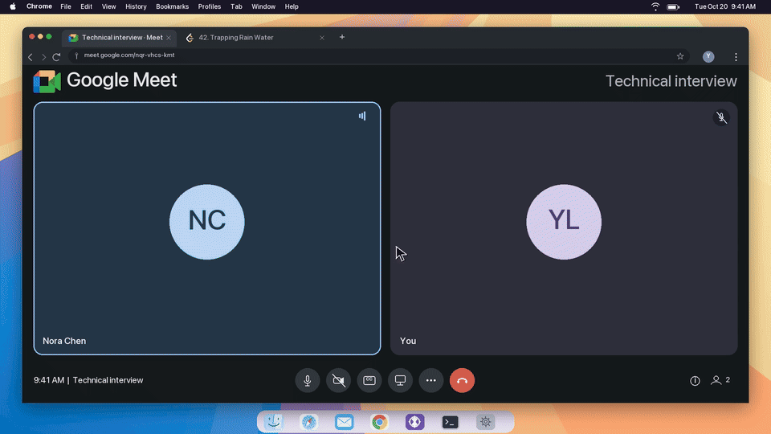
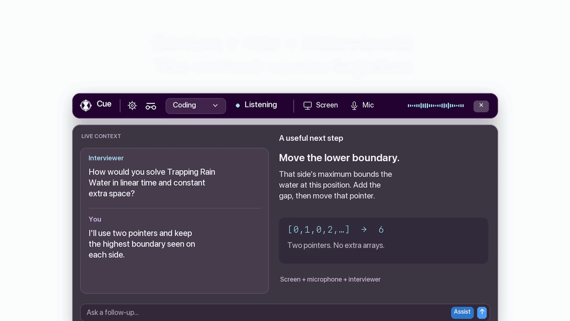
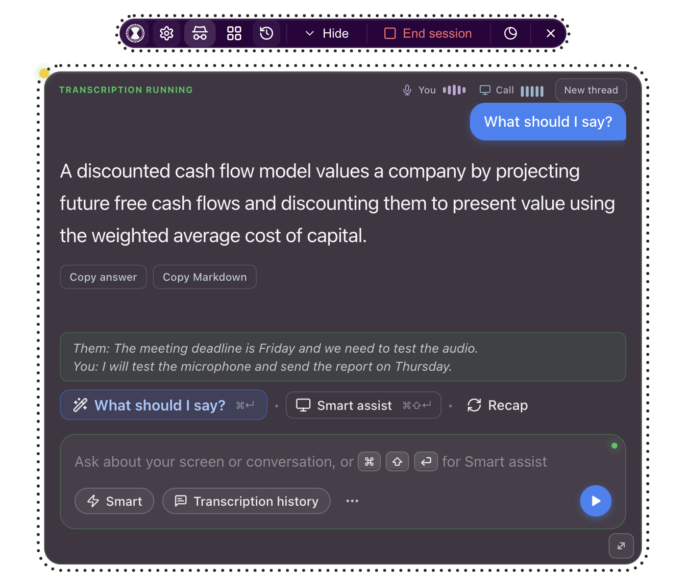
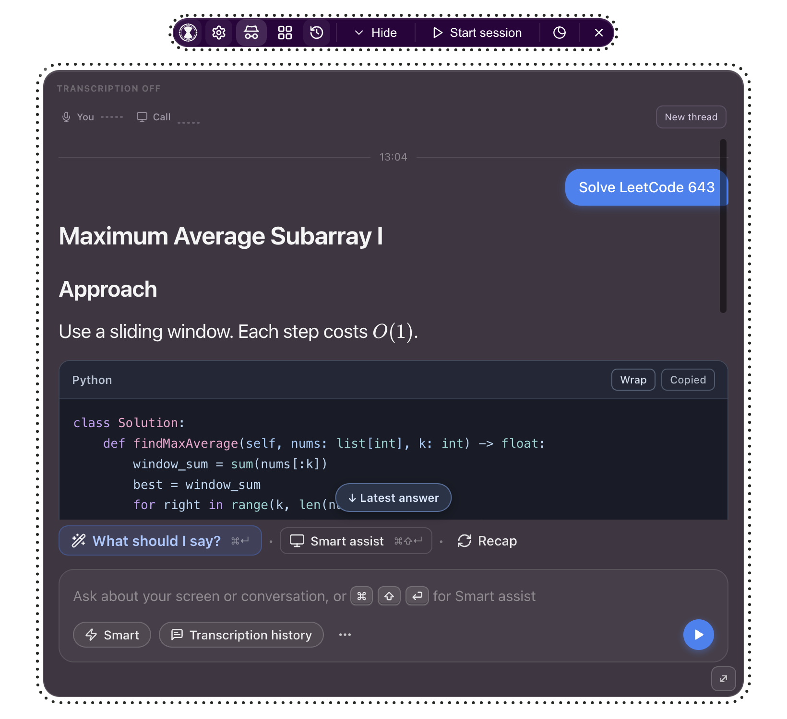

<div align="center">


# Cue

**A small AI companion for your screen and conversations.**

Get help with a question, follow a live discussion, or understand a coding problem without leaving your workspace. Free and open source. Bring your own AI provider key.

[Download for Mac](https://cue.dumpydon.workers.dev/install/) · [Website](https://cue.dumpydon.workers.dev/) · [Watch the launch film](https://cue.dumpydon.workers.dev/#film)

[](https://cue.dumpydon.workers.dev/#film)

*A 21-second preview from our launch film. Click to watch the full 38-second video with sound and captions.*

</div>

> [!IMPORTANT]
> Screen-share protection is **best effort, not a guarantee**. Some capture tools can still show Cue, especially on macOS 15.4 and later. Follow the rules of your meeting, school, or assessment, and get any required consent before capturing a conversation.

## What Cue does

Cue sits above your other apps in a movable, see-through panel. It can use three inputs: your screen, your microphone, and the other side of a call. You choose when to start listening and when to ask for help.

| You want to… | Use | Context |
| --- | --- | --- |
| Find the next words | **What should I say?** | Recent conversation |
| Get help with the current task | **Smart assist** | Screen and conversation |
| Review the discussion | **Recap** | Captured conversation |
| Ask a follow-up | Type a question | Screen, conversation, and the current answer thread |
| Understand a coding problem | Screen coding shortcut | Screenshot of the problem |
| Read previous notes | **Sessions** | Locally saved meetings |

Answers appear as they are generated. **Fast** favors quick replies; **Smart** uses your more capable model. Choose the provider and model for each in Settings. Listening and chat have separate settings, so your speech provider does not have to be your chat provider.

The clips below are illustrations from the launch film. App screenshots use sample conversations and answers; they contain no personal meeting data.



[Watch the full film](https://cue.dumpydon.workers.dev/#film) · [Open the MP4](site/public/media/cue-launch.mp4) · [Read the captions](site/public/media/cue-launch.vtt)

## Get Cue

### Download for Mac

Open the [installation guide](https://cue.dumpydon.workers.dev/install/) or [GitHub Releases](https://github.com/dumpydon/cue/releases). Choose the ZIP for your Mac:

- **Apple silicon:** choose the file ending in `mac-arm64.zip`.
- **Intel:** choose the file ending in `mac-x64.zip`.

Unzip it, move **cue.app** into **Applications**, and open it. Keep one installed copy. Updates are manual: quit Cue, replace the app in Applications, then reopen it. Settings, modes, and saved sessions live separately from the app.

**The current download is a developer preview.** It uses a local development signing certificate. It is **not Apple Developer ID signed or Apple-notarized**, so macOS may block the first launch. Follow the guide's normal **System Settings → Privacy & Security → Open Anyway** steps. Keep macOS security protections enabled.

The download page lists each ZIP's size and SHA-256 checksum. The [release manifest](https://cue.dumpydon.workers.dev/release.json) also records its source commit and signing status. The preview includes the local speech runtime; speech models download separately when you choose one.

Windows and Linux users can build from source. Their downloadable installers are not part of this Mac preview.

### Run from source

Install [Node.js](https://nodejs.org/) **22.12 or later**, then run:

```bash
git clone https://github.com/dumpydon/cue.git
cd cue
npm ci
npm start
```

The app uses Electron and plain JavaScript. Normal startup does not require compiling native modules. Building the optional local speech runtime on macOS does need CMake and Xcode command-line tools; see the build section below.

## First setup

### 1. Add your AI key

Open **Settings → API Keys**, choose a provider, and add your key. Settings is available from the toolbar, the composer’s three-dot button, or `⌘,` on Mac and `Ctrl+,` on Windows.

The public preview uses **your own provider credentials**. No Cue account or subscription is required. Your provider may charge for chat, image, or cloud transcription usage. A ChatGPT or other consumer subscription does not necessarily include API credit; use the key and billing setup required by your provider.

Choose **Fast** and **Smart** models, then save. You can change them later without changing your meeting context. For a first check, type a simple question and confirm that an answer arrives before setting up live audio.

### 2. Allow the inputs you need

Cue opens even if capture permissions are missing. Typed chat, settings, and window controls remain available. Use the toolbar’s **Permissions** button to review access.

| Platform | Microphone | Screen and meeting audio |
| --- | --- | --- |
| macOS | Allow Cue under Privacy & Security → Microphone | Allow Screen Recording; meeting audio needs macOS 14.4+ |
| Windows | Enable Microphone access and Let desktop apps access your microphone | Screen and system-audio capture use Windows capture support |

On Mac, restart Cue if macOS asks after a permission change. **Check Again** only reads the permission status; it does not record or request access again. For a stale grant, see Troubleshooting before changing anything else.

Screen-based actions need screen access. Listening needs microphone access for your voice. On Mac, turn on **Settings → Audio → Meeting audio** to include the other side of a call. macOS shows its recording indicator while system audio is captured.

### 3. Choose transcription

Open **Settings → Audio**. Choose a cloud speech provider with suitable credentials, or choose **Local** for whisper.cpp on your computer. This choice is independent of Fast and Smart chat models.

For local speech, download a model from the same tab. Start with a smaller English or multilingual model that fits your language and hardware. Downloads support cancel and resume, and Cue checks their expected size and checksum. You can import or delete models in Settings.

Local speech does not silently switch to a cloud service if it fails. Model loading and transcription errors are shown in the app. Local processing also needs CPU and memory, so a larger model may be slower during a busy call.

### 4. Check a short session

Press **Start session** and speak a sentence. The **You** waveform should react. If meeting audio is enabled and supported, play some call audio and check the separate **Call** bars. Open **Transcription history** to confirm that words appear under the correct speaker.

Press **End session** when finished. This stops new audio capture and lets the final buffered speech finish. The activity bars flatten immediately. Changing audio providers or capture settings ends the current session; start a new one to use the new settings.

## During a live conversation

### Know what Cue is hearing

The header keeps two quiet indicators beside the transcription status:

- **You:** a microphone icon and centered waveform for your microphone.
- **Call:** a monitor icon and rising bars for system audio.

They follow actual input levels. Silence makes them settle; a muted, missing, or paused source gets its own state. Hover an indicator for details. The two sources work independently, so a quiet microphone does not make an active call look disconnected.

The bars show **incoming sound**, not proof that transcription succeeded. If they move but no words appear, check the transcription status, selected speech provider, and credentials. These indicators do not open an extra recording or send extra model requests.



### Ask for a useful response

Use **What should I say?** for a short suggested reply. Use **Smart assist** when the screen matters too. Type a question when you want to be specific, such as “Summarize their concern” or “Explain the trade-off more simply.”

Cue uses the latest question and the conversation leading up to it. Speech still being transcribed is treated as unfinished. A generated answer is a draft, not evidence that you said it aloud. Review suggestions before using them, especially names, numbers, personal claims, and technical details.

Typed follow-ups share a small answer thread. After an explanation, you can ask “Make that shorter” or “Show a concrete example.” **New thread** clears generated answers and their follow-up context while keeping your live transcript. The thread stays in memory and holds up to six completed exchanges, within a text limit.

Switching the active meeting mode or changing its context starts fresh answer context. Clearing the transcript also clears the thread. Recaps are kept separate from typed follow-ups. [Read more about response context](docs/response-generation.md).

### Keep notes and revisit sessions

Transcription keeps **You** and **Them** separate. The live meter says **Call** for the system-audio input; its transcript appears under **Them**. Both unfinished speech and completed turns can help Cue answer the current question.

Cue saves transcript turns locally as they arrive. A recent interrupted meeting can be restored after relaunch within 30 minutes. Saving reduces the risk of losing a discussion, but a crash before pending writes finish can still lose the latest changes.

After listening stops, Cue can use your chat model to write a summary, key points, decisions, action items, and follow-up questions. Recent meeting summaries may become background for later answers. The current conversation takes priority. This notes step sends the needed transcript to your selected chat provider, including when speech recognition itself was local.

Open **Sessions** from the toolbar’s history icon or the menu to review saved meetings. Cue keeps the newest 50 meetings. These saved sessions are different from the temporary **New thread** answer context.

## Make it fit your work

### Meeting modes

The four-square **Modes** button opens the quick picker. Choose **Manage modes** to edit a mode’s name, context, and files. You can also open Modes from Settings.

Built-in choices include General, Interview, Behavioral Interview, Coding Interview, System Design, Case Interview, Recruiter Screen, Sales, Recruiting, Team Meet, and Lecture. Use a preset as a starting point, then describe your actual task and background.

Editing a mode does not activate it. Choose **Set Active** when ready. Only the active mode’s context and file text accompany your questions. Background meeting notes and slide extraction keep their own factual prompts.

Titles and context save automatically, including before a normal quit or AI request. If saving fails, Cue keeps the draft for retry. You can create, duplicate, delete, and reorder modes. Drag a grip, use the up/down buttons, or focus a grip and press `Alt+Up` or `Alt+Down`. Undo can restore recently deleted modes.

Add PDF, DOCX, TXT, or Markdown files: up to 10 files per mode, 5 MB each. Cue saves extracted text, leaving the originals unchanged. Scanned PDFs need a text layer. Long files are shortened for context, with limits shown in the interface.

### Choose the right context

Use a meeting mode to keep the topic clear. For a project review, add the project goals and constraints. For practice, add only your real experience and the role you are preparing for. A short, focused note usually makes a better starting point than pasting several unrelated documents.

Before using screen help, bring the relevant question or window into view. Keep private messages and unrelated documents out of that view. After Cue answers, check it against the original question. If it missed a requirement, name that requirement in a follow-up so the next reply has a clear target. Keep the same thread for related questions, and start a new one when topics change.

### Your background and answer style

Add a résumé or professional background in Settings to help Cue ground career-related answers. Include the facts you actually want it to use. You can also add the meeting’s purpose or job description to the active mode.

When a fact is missing, Cue is guided to ask or use a placeholder instead of inventing experience. This guidance cannot guarantee accuracy. Clear outdated background before a different conversation, and remove personal details you do not want sent to your chat provider.

### Read, copy, and follow answers

Responses support headings, lists, tables, highlighted code, and mathematical formulas. Formatting appears while the answer streams. Rendering libraries and fonts ship with the app.

Use **Copy answer** for readable text or **Copy Markdown** for the original formatting, code fences, and LaTeX. Each code block has **Copy code** and **Wrap / Unwrap**. Wrapping survives streaming updates. Saved notes use the same formatting.

Scroll up to read an earlier response without being pulled back to the bottom. **Latest answer** returns to new content. A longer answer can scroll while the composer remains available.



### Move, resize, and hide

Drag a non-interactive background to move Cue. Buttons, input fields, text selection, and scrollbars keep their usual behavior. Drag any panel edge or corner to resize. Cue remembers its size and position.

You can park most of the panel beyond the left, right, or bottom screen edge while leaving a small part visible to pull back. Opening Settings or Sessions brings it into view.

**Hide** collapses the panel to its toolbar. The surrounding empty space is click-through. Change opacity from the toolbar, and use `⌘−` / `⌘+` to scale text on Mac, or `Ctrl−` / `Ctrl+` on Windows. `⌘0` / `Ctrl0` restores actual size.

Every fresh launch starts in **incognito**, shown by the hat-and-glasses icon. Clicking it switches to visible mode, shown by an eye and a red indicator. This controls screen-share protection for the current run. It does not stop listening or make capture invisible to macOS.

### Keyboard shortcuts

| Action | Mac | Windows |
| --- | --- | --- |
| What should I say? | `⌘ Enter` | `Ctrl Enter` |
| Smart assist | `⌘ Shift Enter` | `Ctrl Shift Enter` |
| Screen coding help | `⌘ H` | `Ctrl H` |
| Show or expand Cue | `⌘ Shift /` | `Ctrl Shift /` |
| Settings | `⌘ ,` | `Ctrl ,` |
| Quit while expanded | `⌘ Shift X` | `Ctrl Shift X` |

Cue releases its action shortcuts when hidden, collapsed, minimized, or covered by a dialog so other apps can use them. The show/expand shortcut remains available. Incognito alone does not release shortcuts while Cue is visible locally.

## Models and providers

Pick chat and speech separately. A key that can answer text questions may not have permission to transcribe audio. Check your provider’s enabled models, account credit, and API access if one feature works but another fails.

| Provider | Key or setup | In Cue |
| --- | --- | --- |
| OpenAI | [API keys](https://platform.openai.com/api-keys) | Chat, screen context, and supported speech features |
| Anthropic | [Console](https://console.anthropic.com/) | Claude chat and screen help; choose another speech provider |
| Google Gemini | [AI Studio](https://aistudio.google.com/apikey) | Chat and supported transcription |
| Cerebras | [Cloud console](https://cloud.cerebras.ai/) | Chat; configure speech separately |
| Groq | [Console](https://console.groq.com/) | Chat and supported Whisper transcription |
| Deepgram | [Console](https://console.deepgram.com/) | Streaming speech; choose a chat provider separately |
| Azure AI Foundry | [Azure AI](https://ai.azure.com/) | Endpoint, API key, and deployment names for chat |
| DeepSeek | [API keys](https://platform.deepseek.com/api_keys) | Chat; configure speech separately |
| Custom | Your compatible server | Base URL, optional key, and model IDs |

Fast and Smart have editable model lists. Choose a listed model or type an ID your provider supports. Available OpenAI choices can refresh from the provider’s model list; a cached list is used when a live refresh is unavailable. You can refresh manually.

Frequently used models rise in your local list. Deleting a suggestion does not change the active model. The deletion survives relaunch; typing and selecting the same ID adds it back. Avoid copying model names from an old screenshot without checking availability.

For a local OpenAI-compatible server, choose **Custom**. An Ollama server commonly uses `http://127.0.0.1:11434/v1`; enter an installed model ID. Other gateways use their own URL and model names. Custom chat does not automatically make that server your transcription provider.

## Privacy and screen sharing

Cue has no required account or app telemetry. Settings, provider keys, background text, modes, and saved sessions live in local app storage. Local storage is not an encrypted vault; treat exported settings and backups as private.

- **Chat:** your question and needed context go to the chat provider you select.
- **Screenshots:** screen-based actions send the captured image to that provider.
- **Cloud speech:** audio goes to your selected transcription provider.
- **Local speech:** whisper.cpp processes audio on your computer. Chat can still use a cloud provider.
- **Custom endpoints:** requests and credentials go to the Base URL you configure.
- **Saved meetings:** local transcripts may be sent to your chat provider to create notes or provide context.

Downloaded speech models remain on disk until deleted. Clear résumé text in Settings when you no longer want it used. Review the [privacy page](https://cue.dumpydon.workers.dev/privacy/) for more detail.

### Check protection before sharing

Cue asks the operating system to exclude its windows from capture. On Mac, newer capture tools may ignore that request. Windows uses native capture exclusion; older Windows 10 versions can show a black box instead. A camera pointed at your display can always see it.

Test your actual meeting app and capture mode before relying on protection. Incognito is not a promise of privacy in every recorder or platform.

For Zoom, choose **Settings → Share Screen → Advanced → Screen capture mode → Advanced capture with window filtering**, when that option is available. The mode without window filtering can include Cue. macOS limitations still apply.


## Troubleshooting

**The bars move but no transcript appears.** Check the transcription status and selected provider in Settings → Audio. Verify its credentials or local model. Bars measure incoming sound; they do not confirm successful recognition.

**The other person is missing from the transcript.** On Mac, use macOS 14.4+, enable Meeting audio, allow Screen Recording, then start a new session. The You channel can work while Call is unavailable. Confirm that your meeting app is actually producing system audio.

**Permissions are enabled, but Cue still asks for access.** Open Permissions, choose Check Again, and restart the same installed copy once. Keep one Cue app in Applications. If needed, **Repair Cue’s screen grant** resets only Cue’s Screen Recording grant, then restarts and requests it once. It does not clear microphone permission or app data.

**A provider returns 403, a model error, or a quota error.** Check the key’s permissions, model ID, and account credit. Chat access alone may not include audio or image access. Choose a speech-capable provider separately if necessary.

**Local speech says the runtime or model is missing.** Source users should run `npm run prepare:whisper`. Packaged previews include the runtime. Download or import a model in Settings → Audio. If a download fails verification, remove the incomplete model and retry.

**A local model is slow.** Try a smaller or quantized model and close other heavy apps. Download size is not the amount of memory required at runtime. Choose a model suitable for your computer and language.

**Custom cannot connect.** Confirm the server is running, the Base URL includes `/v1` where required, and the model ID exists on that server. Configure any required key. Custom speech must be explicitly selected on a compatible endpoint.

**Cue appears in a screen share.** Check incognito and the meeting app’s capture settings. Try Zoom’s filtering mode if available. Some macOS tools can still capture Cue; protection remains best effort.

**macOS blocks the download.** Follow the [installation guide](https://cue.dumpydon.workers.dev/install/) for the developer preview. Verify the checksum and use the official download. For a “damaged” or malware warning, stop and [report it](https://github.com/dumpydon/cue/issues) rather than disabling security controls.

**How do I quit without a Dock icon?** Use the toolbar’s × button or the Quit shortcut while Cue is expanded. In visible mode, the menu-bar icon also offers Quit. A hidden menu-bar icon in incognito is expected.

**`npm start` fails with a `getPath` error.** Your terminal may have `ELECTRON_RUN_AS_NODE=1` set. Clear it with `unset ELECTRON_RUN_AS_NODE`, or `Remove-Item Env:\ELECTRON_RUN_AS_NODE` in PowerShell, then restart.

## Build and contribute

You can build Cue for your platform and run its checks locally:

```bash
npm test                  # unit tests
npm run pack              # unpacked app for this platform
npm run pack:win          # unpacked Windows app
npm run dist:mac          # separate Apple silicon and Intel ZIPs
npm run dist:win          # Windows installer
npm run dist:linux        # Linux x64 AppImage
```

Preparing local speech from source uses the pinned whisper.cpp runtime:

```bash
npm run prepare:whisper
npm run verify:whisper-runtime
```

Windows and Linux use verified speech-runtime binaries. macOS builds the pinned source with CMake and Xcode command-line tools. Mac packaging includes this runtime when `CUE_BUNDLE_WHISPER=1`; Windows and Linux include it by default unless explicitly disabled. Model weights are separate downloads.

<details>
<summary>Mac signing, updates, and permission continuity</summary>

Public production releases need Apple Developer ID signing and notarization. The current preview is the explicitly approved local-development exception and must remain clearly labeled.

For a local update, finish editing the bundle before signing. Use the approved persistent identity with `node scripts/sign-local-macos.cjs /path/to/cue.app`. It checks the certificate and continuity with the previous signature. The private key stays in Keychain; its public configuration lives outside this repository.

Do not replace a certificate-signed app with ad-hoc signing. Keep rollback builds as ZIPs, with one installed copy in Applications. After updating, verify actual capture and repeat the check after relaunching the unchanged app. Do not reset all privacy permissions to repair one app. See [Mac capture permissions](docs/macos-capture-permissions.md).

</details>

<details>
<summary>Regression checks</summary>

Isolated Electron suites cover live audio, response context, formatting, modes, permissions, shortcuts, and window behavior. For example:

```bash
node_modules/.bin/electron scripts/smoke-audio-context.cjs
node_modules/.bin/electron scripts/smoke-response-context.cjs
node_modules/.bin/electron scripts/smoke-answer-format.cjs
```

These suites use temporary profiles and synthetic sources. They check behavior without using your microphone, meeting history, provider keys, or paid model accounts. They do not replace a real capture check on the final signed app.

</details>

Issues and pull requests are welcome. Include your operating system, Cue version, affected action, and a safe reproduction. Remove API keys, personal transcripts, and private screenshots from reports. Keep settings, profiles, downloaded models, signing keys, and build archives out of commits.

## License

Local transcription uses [whisper.cpp](https://github.com/ggml-org/whisper.cpp), under the MIT License. Packaged runtimes include its license notice. Other third-party components retain their license notices.

**[GPL-3.0-or-later](LICENSE).**
